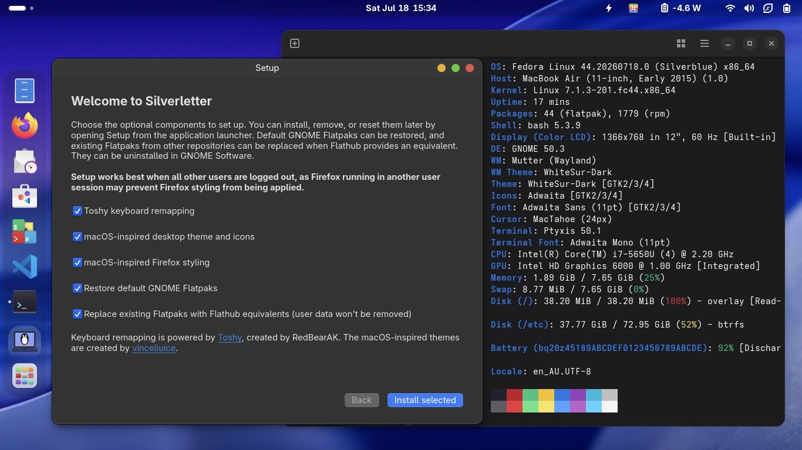

<h1>
  
  Silverletter
</h1>

**A love letter to 'old' hardware, delivered as a bootc image**

Silverletter is a bootable container for selected Intel Mac computers, based on [Fedora Silverblue](https://fedoraproject.org/atomic-desktops/silverblue/). It currently tracks [Fedora 44](https://fedoraproject.org).

Instead of relegating my 11-year-old, 11-inch laptop to the gap in my couch - I wanted a reliable, modern and secure system with all necessary drivers included, kept close to its upstream base, and carefully tuned to **maximise battery life***.

This began as a playground for bootc using the excellent [Universal Blue image-template](https://github.com/ublue-os/image-template). It became my daily driver in early 2026 and eventually felt worth sharing.

## What's in this image - credits to the maintainers of these projects

- A mostly stock Fedora Silverblue experience using Universal Blue's [`silverblue-main`](https://github.com/ublue-os/main) base image
- Broadcom Wi-Fi from [Universal Blue akmods](https://github.com/ublue-os/akmods), plus the [FaceTime HD driver](https://github.com/patjak/facetimehd) and [firmware extractor](https://github.com/patjak/facetimehd-firmware)
- Thunderbolt power tuning*, PCIe ASPM tuning, firmware compatibility tweaks, [PowerTOP](https://github.com/fenrus75/powertop) tuning, Wi-Fi power saving enable by default
- A smaller, hardware-focused initramfs that reduced boot time from ~40 to ~25 seconds on my machine. The initramfs in [`silverblue-main`](https://github.com/ublue-os/main) is ~230MB+ whereas this image's initramfs is ~75MB. Since updates occur on restart, I figured the faster boot was worth pursuing.
- [mbpfan](https://github.com/linux-on-mac/mbpfan) for MacBook fan control
- [uupd](https://github.com/ublue-os/uupd) automatic system and Flatpak updates, with restart notifications using [uupd Indicator](https://github.com/Vyachean/uupd-indicator)
- GNOME extensions installed and enabled system-wide: [AppIndicator and KStatusNotifierItem Support](https://extensions.gnome.org/extension/615/appindicator-support/), [Xremap](https://extensions.gnome.org/extension/5060/xremap/), [Vitals](https://extensions.gnome.org/extension/1460/vitals/), [User Themes](https://extensions.gnome.org/extension/19/user-themes/), [Dash to Dock](https://extensions.gnome.org/extension/307/dash-to-dock/),
- Thunderbolt* can be enabled or disabled via tray icon

## Optional items

- macOS style keyboard remapping provided by [Toshy](https://github.com/RedBearAK/Toshy)
- macOS inspired desktop and Firefox theming from [WhiteSur GTK, Shell, and GDM styling](https://github.com/vinceliuice/WhiteSur-gtk-theme) 
- Setup app that adds/removes these items and can restore the default GNOME Flatpak apps from [Flathub](https://flathub.org/) aswell as replace existing ones with Flathub counterparts (The upstream image exchanges the Fedora flatpak repo for Flathub's) 

## Screenshot



## Hardware compatibility

The main image is developed and daily-tested on a **2015 11" MacBook Air (`MacBookAir7,1`)**. Its initramfs and power configuration remain intentionally tailored to this generation.

The **2016 12-inch Retina MacBook (`MacBook9,1`)** uses the separate `silverletter-macbook9` image. A separate image is required because kernel arguments take effect before runtime model detection: the Air image requires an ACPI override that interferes with the MacBook9,1 Apple SPI top case, and its Thunderbolt configuration is inapplicable to the MacBook9,1 USB-C port.

Do not assume that other MacBook or MacBook Pro computers are compatible. The trimmed initramfs omits drivers and storage features this specific machine does not need.

These related Intel-based MacBook Air computers are reasonable candidates, but are **untested unless stated otherwise**:

| Model identifier | Apple model | Confidence |
| --- | --- | --- |
| `MacBookAir7,1` | 11-inch, Early 2015 | Daily-tested target |
| `MacBookAir7,2` | 13-inch, Early 2015 or 2017 | Closest sibling; likely candidate |
| `MacBookAir6,1` | 11-inch, Mid 2013 or Early 2014 | Similar generation; untested |
| `MacBookAir6,2` | 13-inch, Mid 2013 or Early 2014 | Similar generation; untested |
| `MacBookAir5,1` | 11-inch, Mid 2012 | Earlier related hardware; least certain |
| `MacBookAir5,2` | 13-inch, Mid 2012 | Earlier related chassis; least certain |
| `MacBook9,1` | 12-inch, Early 2016 | Dedicated image; keyboard and trackpad boot-tested |

### MacBook9,1 image

The dedicated image is published as:

```text
ghcr.io/networkoctopus/silverletter-macbook9:latest
```

It differs from the Air image only where the hardware requires it:

- Uses Fedora's in-tree `applespi`, Intel LPSS/SPI, and `brcmfmac` drivers. The required input and BCM4350 WCC modules are forced into the image initramfs; no legacy Apple SPI DKMS driver is installed.
- Uses Fedora's `brcmfmac-firmware` for the BCM4350 Wi-Fi device (`14e4:43a3`). The proprietary `broadcom-wl` package and its broad `brcmfmac` blacklist are omitted.
- Builds the pinned [MacBook12 CS4208 driver](https://github.com/leifliddy/macbook12-audio-driver) for the image kernel. Mainline detects this codec but does not initialize the MacBook9,1 digital speaker/amplifier path. A model-specific WirePlumber rule supplies software volume control.
- Does not apply the Air-only `acpi_osi=!Darwin` or `pci=hpbussize=8` arguments.
- Does not install or enable the Air's Thunderbolt teardown/UI, fixed-address ASPM and storage workarounds, CPU suspend hook, or `mbpfan`. MacBook9,1 is fanless and has USB-C without Thunderbolt.
- Keeps USB-C data, charging, display paths, and networking under the normal kernel drivers rather than applying Thunderbolt teardown rules.

Current limitations and validation status:

- The internal keyboard and trackpad initialize and work after booting the dedicated image.
- Wi-Fi has been physically probed with `brcmfmac` and can scan 2.4 GHz and 5 GHz networks. The first image boot exposed an early-boot ordering failure because Fedora's split `brcmfmac_wcc` plugin was not in the initramfs; the plugin is now forced into the initramfs. Association, suspend, and resume still need validation.
- The stock kernel enumerates the CS4208 codec and routes PipeWire correctly, but produces no internal-speaker output because it does not initialize the model-specific digital path and amplifier. The replacement driver is build-validated; speaker, headphone, microphone, and resume behavior still need physical validation.
- The lid switch, audio devices, camera, Bluetooth controller, battery, display brightness, NVMe storage, and USB-C hub/charging enumerate on the test machine. End-to-end audio, camera, Bluetooth pairing, external display, lid-close policy, and suspend/resume tests remain pending.
- The Bluetooth controller runs without an optional board-specific `BCM.hcd` patch and reports the missing patch in the kernel log. Because the controller enumerates and powers on, no unverified or unredistributable firmware is bundled. Test pairing before treating this as a failure.
- Keep USB input and Ethernet available when testing a newly built image or kernel.

The driver choices follow the [upstream Apple SPI driver](https://github.com/torvalds/linux/blob/master/drivers/input/keyboard/applespi.c), [Linux Wireless brcmfmac guidance](https://wireless.docs.kernel.org/en/latest/en/users/drivers/brcm80211.html), and Fedora's maintained [brcmfmac-firmware package](https://packages.fedoraproject.org/pkgs/linux-firmware/brcmfmac-firmware/). See [the captured hardware baseline](docs/macbook9-1-baseline.md) for the evidence behind each change.

## *Battery

One of my primary goals was to maximise battery life - this image includes a number of optimisations to help in this regard. 
My 11" machine draws around **4–4.5 W** which equates to ~10 hours of battery life (50% display brightness with Wi-Fi enabled and no apps running).  
With auto-brightness off and brightness at minimum, power usage diops to **3.3–3.5 W**  (Not that I use my machine this way, just for reference)

An unnecessary power draw on this hardware is [unused Thunderbolt controllers](https://wiki.archlinux.org/title/Mac/Troubleshooting#Disabling_Thunderbolt)

> [!IMPORTANT]
> **Thunderbolt is intentionally disabled by default to save power.** If you rely on that port on the daily, this image is probably not for you. I hardly use mine, so the multiple watts—and hours—of power savings are worth it.

Thunderbolt can be temporarily enabled via the included GNOME extension - however it's experimental and will be disabled again at suspend/reboot.

This re-enablement has been tested with an Apple Thunderbolt to Gigabit Ethernet Adapter; other Thunderbolt devices may work but are not guaranteed.

## Power saving audit

There is an included power-audit script which can check if all power saving features are enabled or not:

```bash
sudo power-audit.sh
```


## Switch from another bootc/rpm-ostree system

If you already run a bootc-managed system, inspect its current state first:

```bash
sudo bootc status
```

Then switch to Silverletter and reboot into the new deployment:

```bash
sudo bootc switch ghcr.io/networkoctopus/silverletter:latest
sudo systemctl reboot
```

After rebooting, verify the booted image:

```bash
sudo bootc status
```

If the new deployment does not suit your machine, boot the previous deployment from the boot menu or roll back:

```bash
sudo bootc rollback
sudo systemctl reboot
```

### Test the MacBook9,1 image

Inspect and record any layered packages first. Layering makes the current deployment incompatible with `bootc` image management until the mutation is reset:

```bash
rpm-ostree status -v
```

For the test machine captured in this repository, VS Code is layered as the `code` package. Reset mutations, stage the dedicated image without rebooting, remove the two inherited Air arguments from the staged deployment, and inspect everything before restarting:

```bash
sudo rpm-ostree reset
sudo bootc switch ghcr.io/OWNER/silverletter-macbook9:testing
sudo rpm-ostree kargs --delete-if-present='acpi_osi=!Darwin' --delete-if-present='pci=hpbussize=8'
sudo bootc status
sudo rpm-ostree status -v
```

Replace `OWNER` with the GitHub account or organization that published the test
build. Fork builds can publish without the upstream repository's optional image
signing secret; production builds are signed when that secret is configured.

Do not use `bootc switch --apply` for the first test. Reboot only after confirming the staged image and arranging a fallback input/network path. After a successful hardware test, VS Code can be restored with:

```bash
sudo rpm-ostree install code
```

That creates another pending deployment and therefore requires a later reboot. Alternatively, use the Flatpak or Toolbox version to avoid making the bootc deployment locally derived.

To abandon the staged deployment before rebooting:

```bash
sudo rpm-ostree cleanup --pending
```

After booting the test image, use the boot menu to select the retained previous deployment if input or networking fails. From a working deployment, roll back with:

```bash
sudo bootc rollback
sudo systemctl reboot
```

## Install with the Anaconda ISO

The installer ISO is built weekly. Open the [Build disk images workflow](https://github.com/networkoctopus/Silverletter/actions/workflows/build-iso.yml), select the newest successful scheduled run, and download the artifact from the **Artifacts** section at the bottom of the run page. Extract the archive to get the Anaconda ISO, then write it to a USB drive with your preferred image writer.

Note: GitHub requires you to be signed in to download workflow artifacts.

> [!CAUTION]
> Installing will erase the selected disk/partition. Back up anything important and carefully confirm the target drive in Anaconda.

## Updating

The `latest` image is rebuilt after pushes and **twice weekly**, every Wednesday and Sunday. 

`uupd` checks for and stages system and Flatpak updates automatically. The panel indicator shows update activity and tells you when a reboot is needed to enter the staged deployment. GNOME Software updates are disabled because `uupd` handles them.


## Disclaimer

Have fun, but there are no warranties. This personal project is shared in the hope that it is useful. It has only been validated on the test machine, and may fail to boot or work correctly elsewhere. Keep backups and know how to select an earlier deployment before experimenting.

Silverletter is not provided or supported by Apple, Intel, Red Hat, the Fedora Project, Universal Blue, or the Asahi Linux project. Official Fedora software is available from the [Fedora Project](https://fedoraproject.org/).

Apple, Mac, MacBook Air, MacBook Pro, macOS, and Apple silicon are trademarks of Apple Inc. Intel and Thunderbolt are trademarks of Intel Corporation or its subsidiaries. Fedora is a trademark of Red Hat, Inc. Linux® is the registered trademark of Linus Torvalds in the U.S. and other countries.


## Experimental Apple silicon build using Fedora Asahi Remix

I liked using the above for my 'old' hardware I decided to try it out on my 'new' M2 machine. It's being tested using the experimental and unofficial base image from [Fedora Asahi Remix Atomic Silverblue image](https://github.com/fedora-asahi-remix-atomic-desktops/images). The build shares the desktop customisations without applying the power optimisation of the Intel variant.

The image is published separately as:

```text
ghcr.io/networkoctopus/silverletter-asahi:testing
```
